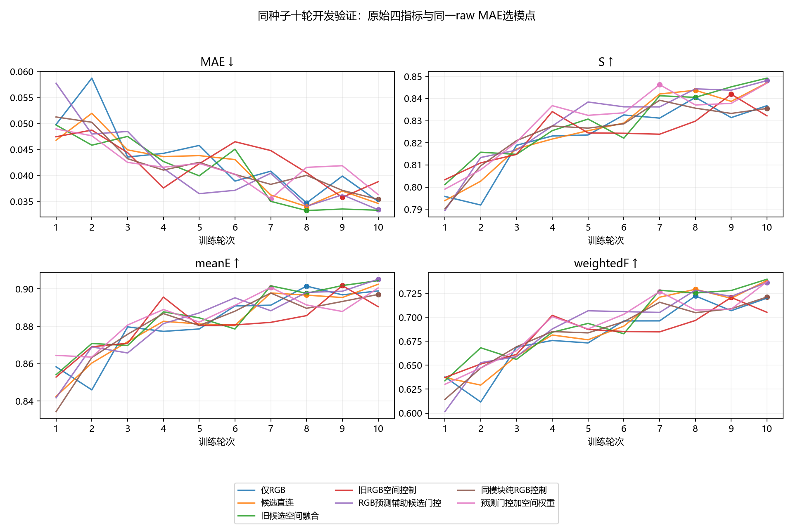

# RGB预测辅助门控执行结果｜2026-11-12

11月13日更新：第二个种子复验四指标均反向，本报告的第一种子改善未能复现为稳定收益。暂不扩大新门控长训，见[双种子完整结果](预测门控双种子结果_20261113.md)。

协议沿用CAM-only 3652/383、种子20261023、十轮/4570次更新、原损失与学习率、最低raw开发MAE选模。四项指标来自同一选中轮次，正式测试集未使用。
普通RGB/直连与旧空间控制复用既有验收记录。新增条件必须通过独立验收才进入完整十轮表。原18:14:27截止后的续跑使用相同冻结源码和完整epoch检查点，旧日志与控制保留。

方案含义：普通直连将候选区域特征通过已有门控送入COD网络；预测辅助门控再利用未融合RGB粗预测，提取候选内外的平均概率、概率差和内外不确定性，共五项统计量，补充原门控判断。背景候选保留，不按角色硬删除。
同模块纯RGB控制使用相同可训练参数，以全图合成区域代替候选并关闭弱角色；空间版本则进一步允许候选内不同位置获得不同权重。空间版本比前两组多启用3072个参数，其与纯RGB控制的差异不能单独作严格等参数归因。

## raw完整十轮开发集比较

|方案|选中轮次|MAE↓|S↑|meanE↑|weightedF↑|
|---|---:|---:|---:|---:|---:|
|仅RGB|8|0.034731|0.840505|0.901501|0.722299|
|候选直连|8|0.034046|0.843740|0.896671|0.729257|
|旧候选空间融合|8|0.033270|0.840542|0.897654|0.725420|
|旧RGB空间控制|9|0.035813|0.841948|0.901804|0.720739|
|RGB预测辅助候选门控|10|0.033426|0.848110|0.905183|0.736420|
|同模块纯RGB控制|10|0.035427|0.835533|0.897029|0.721168|
|预测门控加空间权重|7|0.035522|0.846282|0.900817|0.726845|

## png_standard完整十轮开发集比较

|方案|选中轮次|MAE↓|S↑|meanE↑|weightedF↑|
|---|---:|---:|---:|---:|---:|
|仅RGB|8|0.034617|0.840465|0.903062|0.723576|
|候选直连|8|0.033954|0.844091|0.898459|0.730293|
|旧候选空间融合|8|0.033187|0.840866|0.899775|0.726397|
|旧RGB空间控制|9|0.035724|0.841946|0.903528|0.721593|
|RGB预测辅助候选门控|10|0.033330|0.848461|0.906913|0.737478|
|同模块纯RGB控制|10|0.035343|0.835801|0.898795|0.722031|
|预测门控加空间权重|7|0.035423|0.846637|0.902512|0.727850|

## 本轮判断

预测辅助候选门控相对普通直连的四指标均改善，raw MAE相对下降约1.82%；同模块纯RGB控制四项表现较弱，支持候选信息有额外作用。继续叠加空间权重后四项均弱于仅做预测辅助门控，因此暂不扩大空间版本。
逐图raw MAE为200张改善、183张退化，增益幅度有限。当前结论仅适用于种子20261023的十轮开发筛查，跨种子与充分训练效果需要另行验证。

## 未完成或未验收条件

这些条件不进入十轮公平对比，不据此判定方案优劣。

## CUDA前向计算开销

设备为NVIDIA GeForce RTX 4090，FP32、batch 1、352×352。四轮轮换顺序、四种固定候选数量输入；不含磁盘读取及离线Qwen/SAM生成。

|方案|候选数量分层|各块中位数的中位数(ms)|P90(ms)|峰值分配显存(MiB)|
|---|---|---:|---:|---:|
|仅RGB|five_plus|32.310|47.523|203.86|
|仅RGB|two_to_four|32.439|34.402|203.86|
|仅RGB|empty|32.380|44.470|203.86|
|仅RGB|one|32.282|33.310|203.86|
|候选直连|five_plus|34.901|35.741|204.04|
|候选直连|two_to_four|34.938|35.779|204.04|
|候选直连|empty|34.849|35.518|204.04|
|候选直连|one|34.526|35.447|204.04|
|RGB预测辅助候选门控|five_plus|39.772|40.317|204.05|
|RGB预测辅助候选门控|two_to_four|39.370|39.943|204.05|
|RGB预测辅助候选门控|empty|38.998|39.891|204.05|
|RGB预测辅助候选门控|one|39.073|39.714|204.05|
|同模块纯RGB控制|five_plus|39.387|40.107|204.05|
|同模块纯RGB控制|two_to_four|39.432|39.913|204.05|
|同模块纯RGB控制|empty|39.313|39.811|204.05|
|同模块纯RGB控制|one|39.384|39.852|204.05|

四种输入上，预测门控相对普通直连增加约11.9%–14.0%的前向中位耗时。普通RGB的个别块波动较大，全部块及范围保存在COST_2100/RESULTS.json；不能将该测量当作端到端吞吐或最终部署FPS。
新增113个可训练参数，同时仍保存3072个未启用的空间参数，并多执行一次共享粗解码器。参数增量小并不代表计算代价为零。

## 独立验收与限制

验收总体状态：PASS。逐条件验收、未完成原因和干预信息保存在原始ACCEPTANCE.json。
本轮仅单种子开发集筛查；长训与跨种子稳定性尚未验证。计算开销需在相同硬件、无干扰条件下另测。
新增粗预测不是校准置信度，概率接近0.5只作候选用途判断线索。背景候选并未按弱角色硬删除。
