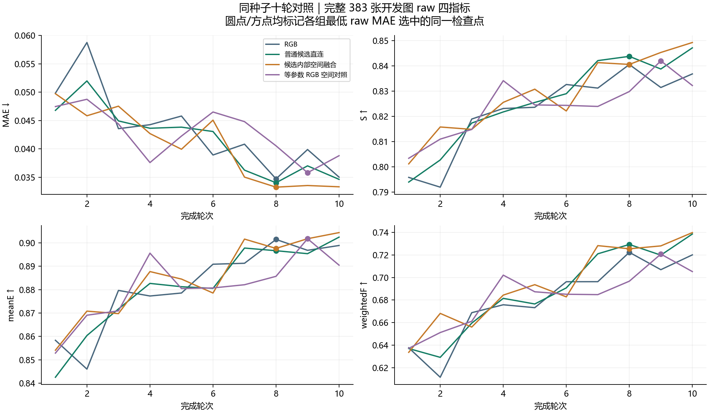

# 候选内部空间融合首轮结果

2026 年 11 月 11 日复核。候选空间融合与等参数 RGB 空间对照均完成 10 轮、4,570 次更新，四组配对验收通过。沿用种子 20261023、CAM-only 3652/383、相同初始化与样本顺序。RGB 和普通候选直连复用同种子已验收的 10 轮记录。

四指标来自各组最低 raw 开发 MAE 选中的同一检查点。训练最后一轮的指标另存于 SUMMARY.json。

## raw

| 方法 | 选中轮次 | MAE ↓ | S ↑ | meanE ↑ | weightedF ↑ |
| --- | ---: | ---: | ---: | ---: | ---: |
| RGB | 8 | 0.034731 | 0.840505 | 0.901501 | 0.722299 |
| 普通候选直连 | 8 | 0.034046 | 0.843740 | 0.896671 | 0.729257 |
| 候选内部空间融合 | 8 | 0.033270 | 0.840542 | 0.897654 | 0.725420 |
| 等参数 RGB 空间对照 | 9 | 0.035813 | 0.841948 | 0.901804 | 0.720739 |

## png_standard

| 方法 | 选中轮次 | MAE ↓ | S ↑ | meanE ↑ | weightedF ↑ |
| --- | ---: | ---: | ---: | ---: | ---: |
| RGB | 8 | 0.034617 | 0.840465 | 0.903062 | 0.723576 |
| 普通候选直连 | 8 | 0.033954 | 0.844091 | 0.898459 | 0.730293 |
| 候选内部空间融合 | 8 | 0.033187 | 0.840866 | 0.899775 | 0.726397 |
| 等参数 RGB 空间对照 | 9 | 0.035724 | 0.841946 | 0.903528 | 0.721593 |

## 本轮判断与下一步

空间融合相对普通直连的 raw MAE 下降 0.000776，meanE 增加 0.000983，同时 S 下降 0.003197、weightedF 下降 0.003837。MAE 改善 193 张、退化 190 张，其中 32 张退化至少 0.01。

相对等参数 RGB 空间对照，候选空间融合的 MAE 和 weightedF 更好，S 和 meanE 更低。本轮结果有取舍，暂不据此追加空间融合 80 轮训练。下一项执行固定候选提示词对照，检查生成阶段能否提供更有用的目标区域。

同权重关闭候选使空间融合的整体四指标均退化，32 张合法空候选的输出保持一致。等参数 RGB 控制在开关候选时逐图输出相同。

来源为 outputs/SPATIAL_FUSION_20261110_V1/ACCEPTANCE.json 及四组已选检查点记录。本地核对新两组的全部 20 份轮次逐图汇总、选中指标和干预检查点。尚未测量新空间模块的选中权重时延。

## 训练过程

图中各方法的标记均取自本组最低 raw MAE 对应的同一个检查点。空间融合第 8 轮的 raw MAE 为 0.033270，第 10 轮为 0.033334，两者相差约 0.000064；同时 weightedF 从 0.725420 上升到 0.739759。十轮内仍有明显指标波动。正式结果沿用预登记的 raw MAE 选模记录，训练曲线用于展示这种取舍。
