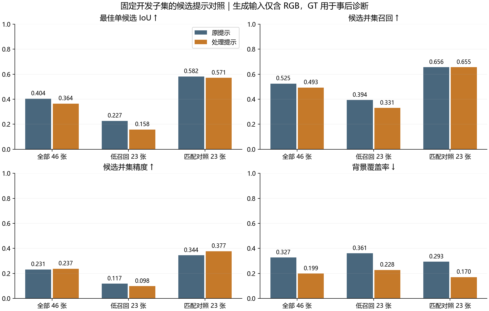

# 候选提示词小样本对照结果

2026 年 11 月 11 日执行，固定 46 张开发图及另列的 4 张流程检查图。原提示与处理提示均重新生成，沿用同一冻结源码、Qwen、SAM3、8 条提示上限、0.5 置信阈值和每提示最多 2 个掩码。处理组只追加已登记的可见目标及部件提示。

生成输入仅含 RGB。GT 用于事后候选几何评价。原提示和处理提示的四个语义生成阶段均未触发格式纠正调用。两组均完成标签、分割、候选包和完整配对审计，生成总窗口为北京时间 12:05 至 12:25。

## 候选几何

| 范围 | 提示 | 平均候选数 | 最佳单候选 IoU | 并集召回 | 并集精度 | 背景覆盖率 | 空候选 | 最佳 IoU ≥0.5 |
| --- | --- | ---: | ---: | ---: | ---: | ---: | ---: | ---: |
| 全部 46 张 | 原提示 | 2.4130 | 0.4042 | 0.5248 | 0.2310 | 0.3271 | 4 | 21 |
| 全部 46 张 | 处理提示 | 2.1522 | 0.3645 | 0.4931 | 0.2375 | 0.1989 | 8 | 19 |
| 低召回 23 张 | 原提示 | 2.3478 | 0.2266 | 0.3937 | 0.1174 | 0.3607 | 3 | 5 |
| 低召回 23 张 | 处理提示 | 1.8261 | 0.1580 | 0.3306 | 0.0978 | 0.2276 | 6 | 3 |
| 匹配对照 23 张 | 原提示 | 2.4783 | 0.5819 | 0.6560 | 0.3445 | 0.2935 | 1 | 16 |
| 匹配对照 23 张 | 处理提示 | 2.4783 | 0.5709 | 0.6555 | 0.3771 | 0.1701 | 2 | 16 |

处理提示减少了背景覆盖，同时降低了目标覆盖和最佳候选 IoU。空候选由 4 张增至 8 张，新增 4 张空候选，原先 4 张均仍为空。低召回组的最佳候选 IoU 从 0.2266 降到 0.1580，并集召回从 0.3937 降到 0.3306。本轮追加提示未实现预期的覆盖改善。

## 固定四例

| 案例 | 原提示最佳 IoU | 处理提示最佳 IoU | 图例观察 |
| --- | ---: | ---: | --- |
| case_01 | 0.8996 | 0.8996 | 虫体候选较准确，两个提示产生相同的目标候选。 |
| case_02 | 0.4641 | 0.4641 | 两个提示均主要覆盖竹节虫主干，细腿漏分仍在。 |
| case_03 | 0.0007 | 0.0007 | 两个提示都没有给出可分割的鱼体目标提示，植物和沙底为主。 |
| case_04 | 0.0830 | 0.0830 | 两个提示均提出人物语义，但对应 SAM3 候选为空；屋顶等背景区域占主导。 |

四例的事后最佳候选 IoU 均未改变。人物例说明语义中出现目标名称后，仍可能在分割阶段失败。竹节虫例的可见细部缺失也未被本次追加提示解决。最佳候选由 GT 事后计算，仅用于本节诊断。

## 同权重分割诊断

固定种子 20261023 的已选直连第 31 轮权重，三组输入在同一套 46 张上评价。原缓存逐图重推复现已验收记录，新生成原提示与原缓存的逐图分割指标完全相同。

### raw

| 范围 | 候选输入 | MAE ↓ | S ↑ | meanE ↑ | weightedF ↑ |
| --- | --- | ---: | ---: | ---: | ---: |
| 全部 46 张 | 原提示 | 0.044615 | 0.704622 | 0.776388 | 0.505939 |
| 全部 46 张 | 处理提示 | 0.044899 | 0.703440 | 0.776386 | 0.504333 |
| 低召回 23 张 | 原提示 | 0.070724 | 0.564260 | 0.623233 | 0.252961 |
| 低召回 23 张 | 处理提示 | 0.071066 | 0.563439 | 0.624638 | 0.251368 |
| 匹配对照 23 张 | 原提示 | 0.018505 | 0.844985 | 0.929543 | 0.758917 |
| 匹配对照 23 张 | 处理提示 | 0.018733 | 0.843442 | 0.928135 | 0.757297 |

### png_standard

| 范围 | 候选输入 | MAE ↓ | S ↑ | meanE ↑ | weightedF ↑ |
| --- | --- | ---: | ---: | ---: | ---: |
| 全部 46 张 | 原提示 | 0.044596 | 0.704619 | 0.778720 | 0.506315 |
| 全部 46 张 | 处理提示 | 0.044881 | 0.703436 | 0.778729 | 0.504705 |
| 低召回 23 张 | 原提示 | 0.070707 | 0.564246 | 0.626200 | 0.253461 |
| 低召回 23 张 | 处理提示 | 0.071049 | 0.563429 | 0.627584 | 0.251856 |
| 匹配对照 23 张 | 原提示 | 0.018485 | 0.844991 | 0.931240 | 0.759170 |
| 匹配对照 23 张 | 处理提示 | 0.018713 | 0.843444 | 0.929873 | 0.757554 |

处理提示相对原提示，raw MAE 改善 12 张、退化 18 张、完全相同 16 张。整体 MAE、S、weightedF 略差，meanE 基本不变。本轮提示改动没有带来固定权重上的整体分割改善。

这些结果属于按 RGB 低召回和匹配规则固定的开发子集。候选几何变化和固定权重的诊断结果分别记录，后续重新训练的完整开发集收益仍需另行验证。
