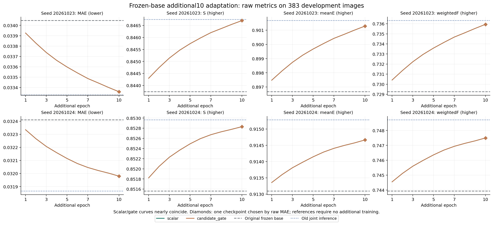
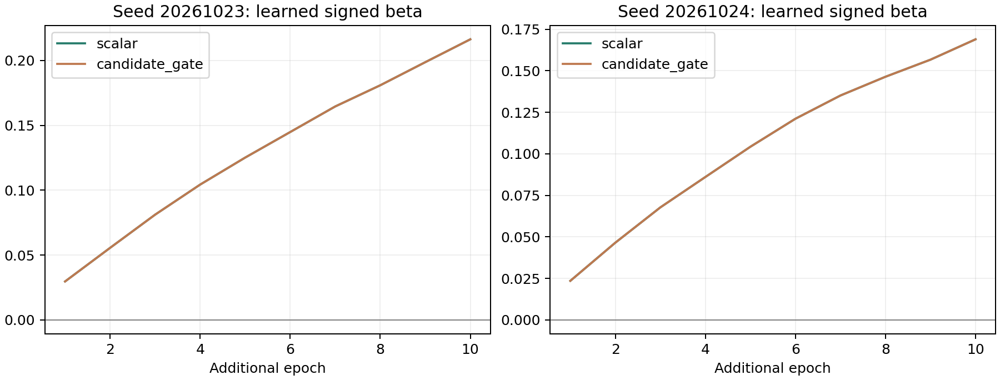

# 可回退补救分支：双种子额外十轮结果

固定各自原候选10轮已选基座，额外训练新增分支10轮；原基座参数与运行统计不变。原模型与旧联合补救推理为不额外训练参考，不与适配条件混称相同总训练预算。3652训练/383开发，官方测试集未使用。

两种子×两条件均完成并通过独立验收和本地复算；每组只按raw开发MAE选一个检查点，raw/PNG全部四指标取同一检查点。关闭新增分支、关闭全部先验的383图均精确回到原对应参考；220无新增候选图精确不变。

原四小时队列的BUDGET_ENDED保留作历史记录；若由独立续跑补齐，本报告以CONTINUATION_20261114_V1的终态、原训练签名和两个配对验收为完成依据。第9轮被首次截止打断的计算单列，不能以已提交优化器更新数代表全部计算成本。

## raw

|种子|条件|选中轮|MAE↓|S↑|meanE↑|weightedF↑|
|---|---|---:|---:|---:|---:|---:|
|20261023|original|8|0.034046|0.843740|0.896671|0.729257|
|20261023|old_joint_inference|8|0.033328|0.846752|0.901674|0.736318|
|20261023|scalar|10|0.033360|0.846704|0.901289|0.735944|
|20261023|candidate_gate|10|0.033360|0.846704|0.901289|0.735944|
|20261024|original|9|0.032410|0.851561|0.913095|0.743935|
|20261024|old_joint_inference|9|0.031866|0.852964|0.915278|0.748706|
|20261024|scalar|10|0.031980|0.852831|0.914664|0.747498|
|20261024|candidate_gate|10|0.031980|0.852831|0.914664|0.747498|

## png_standard

|种子|条件|选中轮|MAE↓|S↑|meanE↑|weightedF↑|
|---|---|---:|---:|---:|---:|---:|
|20261023|original|8|0.033954|0.844091|0.898459|0.730293|
|20261023|old_joint_inference|8|0.033234|0.847110|0.903447|0.737351|
|20261023|scalar|10|0.033266|0.847059|0.903058|0.736977|
|20261023|candidate_gate|10|0.033266|0.847059|0.903058|0.736977|
|20261024|original|9|0.032323|0.851901|0.914933|0.744842|
|20261024|old_joint_inference|9|0.031779|0.853304|0.917165|0.749604|
|20261024|scalar|10|0.031893|0.853172|0.916533|0.748399|
|20261024|candidate_gate|10|0.031893|0.853172|0.916533|0.748399|

## 配对差异

|种子|对照|ΔMAE|ΔS|ΔmeanE|ΔweightedF|MAE相对变化|
|---|---|---:|---:|---:|---:|---:|
|20261023|scalar − original|-0.000686|+0.002964|+0.004618|+0.006687|-2.01%|
|20261023|candidate_gate − original|-0.000686|+0.002965|+0.004618|+0.006687|-2.01%|
|20261023|candidate_gate − scalar|-0.000000|+0.000000|+0.000000|+0.000000|-0.00%|
|20261023|scalar − old_joint_inference|+0.000031|-0.000048|-0.000385|-0.000374|+0.09%|
|20261023|candidate_gate − old_joint_inference|+0.000031|-0.000048|-0.000385|-0.000374|+0.09%|
|20261024|scalar − original|-0.000430|+0.001270|+0.001570|+0.003563|-1.33%|
|20261024|candidate_gate − original|-0.000430|+0.001270|+0.001570|+0.003563|-1.33%|
|20261024|candidate_gate − scalar|-0.000000|+0.000000|+0.000000|+0.000000|-0.00%|
|20261024|scalar − old_joint_inference|+0.000114|-0.000132|-0.000613|-0.001208|+0.36%|
|20261024|candidate_gate − old_joint_inference|+0.000114|-0.000132|-0.000613|-0.001208|+0.36%|

## 误分与漏分

raw概率固定0.5阈值，各值为逐图宏平均；GT仅用于输出之后的分析。误分连通块不等同实例或遮挡，也不自动判定石块或另一个生物。

|种子|条件|背景误分率↓|目标漏分率↓|最大误分块占图比例↓|
|---|---|---:|---:|---:|
|20261023|original|0.013574|0.207014|0.006196|
|20261023|old_joint_inference|0.013932|0.194423|0.006411|
|20261023|scalar|0.013823|0.195862|0.006384|
|20261023|candidate_gate|0.013823|0.195862|0.006384|
|20261024|original|0.018733|0.166001|0.009334|
|20261024|old_joint_inference|0.018933|0.157554|0.009529|
|20261024|scalar|0.018825|0.159969|0.009466|
|20261024|candidate_gate|0.018825|0.159969|0.009466|

## 完整轮数与实际更新

|种子|条件|轮数|批次访问|实际更新|全空跳过|选中beta|条件耗时秒|
|---|---|---:|---:|---:|---:|---:|---:|
|20261023|scalar|10|4570|4537|33|+0.216321|8252.6|
|20261023|candidate_gate|10|4570|4537|33|+0.216317|7596.5|
|20261024|scalar|10|4570|4536|34|+0.168937|8252.9|
|20261024|candidate_gate|10|4570|4536|34|+0.168934|7683.8|

条件耗时含训练、逐轮开发评价和末尾干预，不含离线候选生成与冻结准备；两个种子在两张空闲GPU上并行，不能将条件耗时之和当作墙钟时间。此前约3%的前向开销只来自固定小样本，不代表本轮端到端开销。

## 当前结论

固定基座后的两种适配均较原模型四指标改善，但都没有超过既有“不额外训练、仅追加候选”的联合推理参考。候选门控和单标量在本预算内几乎完全重合，不能将整体改善归因于候选门控，更不能据此宣称学会主辅排序。

- 20261023：门控减单标量的raw MAE为-1.95133964e-08，S/meanE/weightedF分别为+6.81776366e-08/+1.23641592e-07/+1.85469847e-07。
- 20261024：门控减单标量的raw MAE为-2.98789194e-09，S/meanE/weightedF分别为+7.9391228e-09/+1.94010707e-08/+3.04172771e-08。

四组均选中最后第10轮，曲线仍在改善，因而也不能据此断言充分适配必然无效。下一步先检查门控实际数值、梯度与固定权重干预，再决定收敛预算或新结构；当前保留单标量强对照，不自动扩大门控80轮。

## 解读边界

beta是有符号的可学习残差强度，不是目标存在概率。候选门控没有质量真值监督，不能仅凭参数非零断言学会可靠性。两个种子与开发选模不足证明独立测试泛化；不根据本结果回改GT、清单、候选或选模，不自动启动80轮。具体是否保留候选门控，须结合四指标、误分与逐图退化解释，收益近似时优先简单方案。

[协议、源码冻结及执行边界](可回退补救分支正式训练_20261114.md)。

