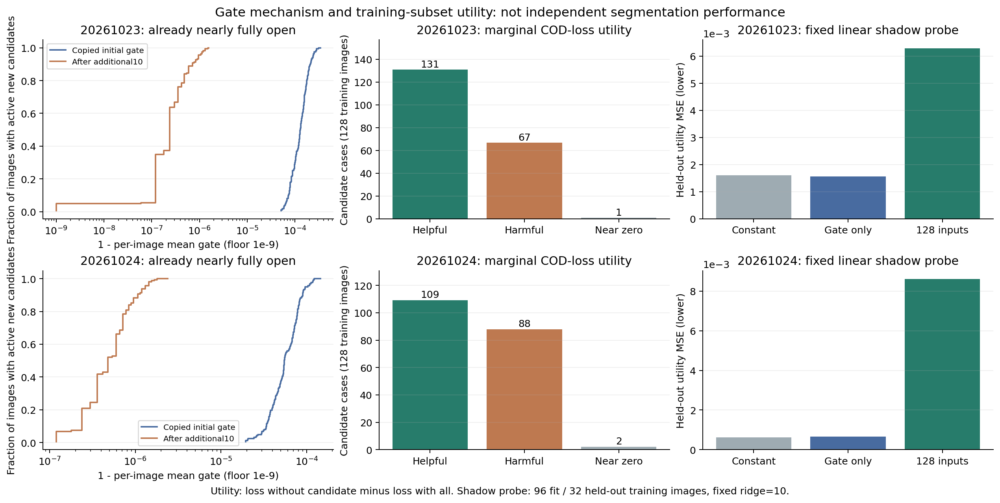

# 新增候选门控：固定强度机制诊断

每种子使用完成十轮后按raw开发MAE已选的candidate_gate检查点。固定其beta、编码器/投影与基座，只临时改变门控函数；不训练、不重新选模，不使用官方测试集。该开关诊断不能替代相应方法的独立重训。

real为学到的门控；initial_gate恢复原门控；initial_mean_matched保留初始排序、以logit平移匹配逐图学到门控均值；constant_half固定0.5；off关闭新增分支。均值匹配不读GT，单有效新增候选时与真实门控精确相同。

initial_gate_base_strength进一步使用原基座已有alpha_direct作为预定强度参考，检查学习到的beta是否只是尚未到相近尺度。其强度来自原检查点，不对开发GT搜索；该行属于机制干预，不是新训练方法，不能与同beta的门控消融混称。

## raw

|种子|干预|MAE↓|S↑|meanE↑|weightedF↑|
|---|---|---:|---:|---:|---:|
|20261023|real|0.03335981|0.84670404|0.90128942|0.73594405|
|20261023|initial_gate|0.03335984|0.84670394|0.90128923|0.73594376|
|20261023|initial_mean_matched|0.03335981|0.84670404|0.90128942|0.73594405|
|20261023|initial_gate_base_strength|0.03322472|0.84721845|0.90223773|0.73731498|
|20261023|constant_half|0.03352841|0.84602989|0.90007589|0.73426642|
|20261023|off|0.03404582|0.84373954|0.89667117|0.72925688|
|20261024|real|0.03197994|0.85283139|0.91466449|0.74749815|
|20261024|initial_gate|0.03197995|0.85283137|0.91466444|0.74749807|
|20261024|initial_mean_matched|0.03197994|0.85283139|0.91466449|0.74749815|
|20261024|initial_gate_base_strength|0.03179443|0.85316612|0.91548246|0.74917227|
|20261024|constant_half|0.03208014|0.85259812|0.91428380|0.74662297|
|20261024|off|0.03240990|0.85156102|0.91309493|0.74393488|

## png_standard

|种子|干预|MAE↓|S↑|meanE↑|weightedF↑|
|---|---|---:|---:|---:|---:|
|20261023|real|0.03326600|0.84705915|0.90305830|0.73697687|
|20261023|initial_gate|0.03326603|0.84705903|0.90305810|0.73697657|
|20261023|initial_mean_matched|0.03326600|0.84705915|0.90305830|0.73697687|
|20261023|initial_gate_base_strength|0.03313062|0.84757540|0.90401438|0.73834656|
|20261023|constant_half|0.03343513|0.84638200|0.90184180|0.73529984|
|20261023|off|0.03395429|0.84409096|0.89845915|0.73029318|
|20261024|real|0.03189284|0.85317167|0.91653320|0.74839916|
|20261024|initial_gate|0.03189285|0.85317165|0.91653316|0.74839910|
|20261024|initial_mean_matched|0.03189284|0.85317167|0.91653320|0.74839916|
|20261024|initial_gate_base_strength|0.03170766|0.85350562|0.91737506|0.75006860|
|20261024|constant_half|0.03199290|0.85293860|0.91614185|0.74752691|
|20261024|off|0.03232262|0.85190108|0.91493301|0.74484184|

## 候选分配自由度

|种子|单新增候选图|多新增候选图|存储有新增但输入无有效新增|选中beta|
|---|---:|---:|---:|---:|
|20261023|109|54|0|+0.216317|
|20261024|109|54|0|+0.168934|

## real减去各控制的raw变化

|种子|范围|对照|ΔMAE|ΔS|ΔmeanE|ΔweightedF|
|---|---|---|---:|---:|---:|---:|
|20261023|all383|initial_gate|-0.00000003|+0.00000011|+0.00000018|+0.00000028|
|20261023|all383|initial_mean_matched|+0.00000000|-0.00000000|-0.00000000|-0.00000000|
|20261023|all383|constant_half|-0.00016860|+0.00067415|+0.00121353|+0.00167763|
|20261023|multi_added|initial_gate|-0.00000007|+0.00000029|+0.00000052|+0.00000069|
|20261023|multi_added|initial_mean_matched|+0.00000000|-0.00000000|-0.00000000|-0.00000000|
|20261023|multi_added|constant_half|-0.00037259|+0.00194577|+0.00344359|+0.00415729|
|20261024|all383|initial_gate|-0.00000001|+0.00000002|+0.00000004|+0.00000008|
|20261024|all383|initial_mean_matched|+0.00000000|-0.00000000|+0.00000000|+0.00000000|
|20261024|all383|constant_half|-0.00010019|+0.00023326|+0.00038069|+0.00087518|
|20261024|multi_added|initial_gate|-0.00000002|+0.00000006|+0.00000020|+0.00000021|
|20261024|multi_added|initial_mean_matched|+0.00000000|-0.00000000|+0.00000000|+0.00000000|
|20261024|multi_added|constant_half|-0.00018245|+0.00053583|+0.00158556|+0.00214559|

## 固定训练子集的任务有用性诊断

先按image SHA选128张有新增候选的训练图，再使用原epoch0增强。正值表示在当前候选集合中保留该候选降低原深监督损失；该边际效应不可相加。GT不进入模型输入、候选生成或过滤，没有训练新头。1e-6只作正/负/近零分析容差。相关性来自训练子集，不是泛化结论或质量真值。

|种子|有效候选案例|有益/有害/近零|门控秩相关|SAM分数秩相关|GT纯度秩相关|
|---|---:|---|---:|---:|---:|
|20261023|199|131/67/1|+0.1649|+0.0346|+0.4356|
|20261024|199|109/88/2|+0.0692|+0.0069|+0.3107|

## 门控饱和与影子探针

有效门控在正式十轮后几乎全为1。复制来的初始门控也已经很接近1；恢复初始门控或保留初始排序且匹配均值，结果几乎不变。因此现有结果不支持“候选门控已学会可靠筛选”，也不支持仅因参数更多就扩长训。

|种子|初始门控最小/最大|训练后门控最小/最大|
|---|---|---|
|20261023|0.999643922 / 0.999948382|0.999997616 / 1.000000000|
|20261024|0.999855757 / 0.999980569|0.999997616 / 0.999999881|

固定128训练图中前96图拟合，后32图按图像分组留出，岭系数固定10，只使用拟合集归一化，不按留出结果调参。基座已见过这些训练图，所以这只是训练子集影子观察头的留出，不是独立COD泛化；预测没有反馈给COD。

|种子|观察头|留出候选数|MSE↓|MAE↓|秩相关|非近零符号正确率|
|---|---|---:|---:|---:|---:|---:|
|20261023|constant|48|0.00160818|0.023777|未定义|0.7083|
|20261023|current_gate_ridge|48|0.00156241|0.022697|+0.2777|0.6875|
|20261023|gate_inputs_ridge|48|0.00628820|0.061115|+0.2659|0.6250|
|20261024|constant|48|0.00061727|0.017581|未定义|0.5435|
|20261024|current_gate_ridge|48|0.00065858|0.017638|-0.0518|0.5435|
|20261024|gate_inputs_ridge|48|0.00860528|0.066878|+0.0224|0.5870|

128维输入的线性探针在两个种子的留出MSE均差于常量。当前样本小、候选相关且只检验固定线性模型，不能据此断言输入完全没有信息；但也没有证据支持直接加大质量头。SAM分数与边际任务收益的相关性很弱，GT纯度也不是辅助用途真值。下一步应先检查可训练性，再单独检验对原候选集合的条件信息。

## 修复原型：保持起点的新调制器

固定旧门控，新加零初始化的乘性因子2×sigmoid(a)，起始精确等于1，beta仍从0开始。起点与标量分支相同；因子表示支持强度，不是候选质量概率。

两个种子各4张真实训练图在beta=0.1时输出、损失和beta梯度匹配；新头绝对梯度和约为旧头的1838–17404倍。该比值只说明这8次起点梯度检查，不能等同训练速度或性能倍数。beta=0第一步头梯度为0、第二步正常非零，符合残差启动方式。关闭/空候选精确回退、原模型参数与buffer不变；不保留烟测权重。

将新头固定在零后，复用原标量选中检查点，两个种子完整383图的raw/PNG指标、逐图概率评估及误分统计精确重放。这是兼容性验收，不是新方法的分割成绩。正式短试验另列，不能把梯度恢复写作性能已经提高。

该参数化也将有效支持系数上界由原sigmoid的1扩展到最多2，且系数同时进入新增残差的分子和分母。因此后续指标变化不能纯粹归因于梯度修复，也不总等价于把beta乘一个常数。需要仅bias调制训练控制及保持逐图有效门控均值的分配干预，分别检查尺度、训练轨迹和候选分配。

[完整训练对照](可回退补救分支训练结果_20261114.md) · [本次预登记与后续路线](三小时推进与后续路线_20261114.md)。

