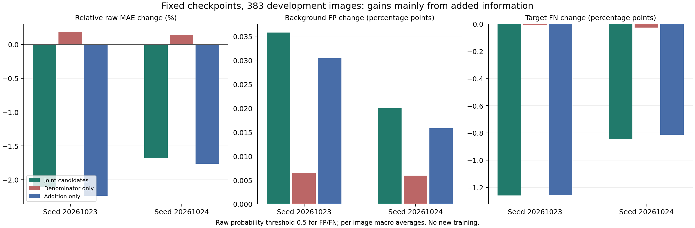

# 新增候选：固定权重的分母与新增信息诊断

两个既有原候选10轮检查点、完整383开发图；不训练、不重新选模、不改候选/GT/划分，不使用官方测试集。baseline和joint均逐图精确复现已有记录；220张无新增候选图在全部干预下精确不变。

baseline为原候选；joint为已有联合补救输入；denominator_only仅改变原候选分母；addition_only保持原贡献并增加新候选的已门控分子项。后两者属于固定权重机制干预，不是训练完成的新方法。解码器非线性，最终指标变化不能相加。

## raw

|种子|干预|MAE↓|S↑|meanE↑|weightedF↑|
|---|---|---:|---:|---:|---:|
|20261023|baseline|0.034046|0.843740|0.896671|0.729257|
|20261023|joint|0.033328|0.846752|0.901674|0.736318|
|20261023|denominator_only|0.034108|0.843611|0.896536|0.728796|
|20261023|addition_only|0.033284|0.846901|0.901779|0.736707|
|20261024|baseline|0.032410|0.851561|0.913095|0.743935|
|20261024|joint|0.031866|0.852964|0.915278|0.748706|
|20261024|denominator_only|0.032456|0.851493|0.913014|0.743639|
|20261024|addition_only|0.031838|0.853025|0.915309|0.748866|

## png_standard

|种子|干预|MAE↓|S↑|meanE↑|weightedF↑|
|---|---|---:|---:|---:|---:|
|20261023|baseline|0.033954|0.844091|0.898459|0.730293|
|20261023|joint|0.033234|0.847110|0.903447|0.737351|
|20261023|denominator_only|0.034016|0.843963|0.898322|0.729833|
|20261023|addition_only|0.033190|0.847257|0.903552|0.737740|
|20261024|baseline|0.032323|0.851901|0.914933|0.744842|
|20261024|joint|0.031779|0.853304|0.917165|0.749604|
|20261024|denominator_only|0.032369|0.851834|0.914847|0.744547|
|20261024|addition_only|0.031751|0.853365|0.917199|0.749763|

## 背景误分与目标漏分（raw概率固定0.5阈值）

各值均为逐图计算后的宏平均。最大背景误分连通块使用8邻接，以整图面积归一化；仅作误扩张诊断，不把连通块等同实例，也不能自动判断某块是否像石头。GT只参与事后统计，不进入模型。

|种子|范围|干预|背景误分率↓|目标漏分率↓|最大误分块占图比例↓|
|---|---|---|---:|---:|---:|
|20261023|all|baseline|0.013574|0.207014|0.006196|
|20261023|all|joint|0.013932|0.194423|0.006411|
|20261023|all|denominator_only|0.013639|0.206907|0.006226|
|20261023|all|addition_only|0.013878|0.194459|0.006405|
|20261023|added_163|baseline|0.013385|0.259176|0.005892|
|20261023|added_163|joint|0.014226|0.229591|0.006398|
|20261023|added_163|denominator_only|0.013538|0.258924|0.005964|
|20261023|added_163|addition_only|0.014100|0.229677|0.006383|
|20261024|all|baseline|0.018733|0.166001|0.009334|
|20261024|all|joint|0.018933|0.157554|0.009529|
|20261024|all|denominator_only|0.018792|0.165735|0.009358|
|20261024|all|addition_only|0.018891|0.157864|0.009502|
|20261024|added_163|baseline|0.018387|0.201122|0.008990|
|20261024|added_163|joint|0.018856|0.181274|0.009450|
|20261024|added_163|denominator_only|0.018527|0.200498|0.009047|
|20261024|added_163|addition_only|0.018758|0.182002|0.009386|

## 验收与边界

最大特征分解残差为9.53674316e-07；采用明确的float32容差检验，未将其表述为位精确的两项加法。真实baseline/joint的完整指标重放仍要求精确一致。

本轮没有新的学习分支，不能把干预结果当作双种子重训收益。人为偏好是优先避免明显背景误分、允许少量细节漏分；本轮仍报告全部四指标和漏分，避免通过整体压低前景掩盖问题。分母衰减可能有益或有害，须根据实际结果解释。

## 结果解释与下一步

两个种子的仅分母干预均轻微退化，raw MAE分别相对原模型升高0.182%与0.142%。保持原贡献、只加新增信息，比现有联合输入的MAE再降低0.135%与0.087%。这支持避免无意扰动原分支，但量级很小，不能将先前重训不稳定主要归因于分母。

新增信息带来的收益更明显：addition_only相对原模型MAE下降2.239%与1.765%，其余三指标均改善。它仍是固定权重的机制干预，采用旧联合分母下的新增项，不等同于后续独立归一化、可学习的新分支。

漏分与误分存在权衡。joint的目标漏分率分别下降约1.259与0.845个百分点，背景误分率增加约0.036与0.020个百分点；两者分母分别为目标像素和背景像素，不能直接抵消。新增信息分支也没有消除背景误分，因此下一步以候选级可靠性门控为重点，持续同时检查漏分。

先实现“固定原模型＋可关闭新增残差”的单标量与候选级门控，验证关闭、无候选、零门控精确回退，参数及BatchNorm运行统计固定。只有实现验收通过后才登记同预算训练；不直接扩大80轮，也不把局部实现测试当作性能验证。

