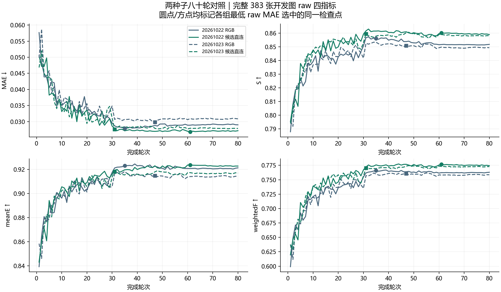

# 独立种子 80 轮复核结果

2026 年 11 月 11 日复核。种子 20261023 的直连完成 80 轮、36,560 次更新，与 RGB 的配对验收通过。续训在北京时间 01:09 获得 GPU 2，06:43 完成训练及验收。第 33 轮检查点的优化器、调度器、历史最佳权重均被保留，最终仍选中第 31 轮。

沿用 CAM-only 3652/383、352 输入、batch 8、FP32、原损失和学习率计划。每组根据最低 raw 开发 MAE 选择唯一检查点，四项指标在该点报告。原状态页保留中断记录，续训完成状态以 RESUME_20261110/STATUS.json 和配对 ACCEPTANCE.json 为准。

## raw

| 方法 | 选中轮次 | MAE ↓ | S ↑ | meanE ↑ | weightedF ↑ |
| --- | ---: | ---: | ---: | ---: | ---: |
| 20261022 RGB | 35 | 0.027884 | 0.856081 | 0.922938 | 0.765909 |
| 20261022 候选直连 | 61 | 0.026824 | 0.860170 | 0.923619 | 0.776774 |
| 20261023 RGB | 47 | 0.029844 | 0.850841 | 0.914846 | 0.760594 |
| 20261023 候选直连 | 31 | 0.027578 | 0.859372 | 0.918118 | 0.770164 |

| 种子 | MAE 相对下降 | ΔS | ΔmeanE | ΔweightedF |
| --- | ---: | ---: | ---: | ---: |
| 20261022 | 3.80% | +0.004090 | +0.000681 | +0.010865 |
| 20261023 | 7.59% | +0.008531 | +0.003272 | +0.009570 |

## png_standard

| 方法 | 选中轮次 | MAE ↓ | S ↑ | meanE ↑ | weightedF ↑ |
| --- | ---: | ---: | ---: | ---: | ---: |
| 20261022 RGB | 35 | 0.027865 | 0.856783 | 0.924312 | 0.766112 |
| 20261022 候选直连 | 61 | 0.026813 | 0.860493 | 0.924873 | 0.776902 |
| 20261023 RGB | 47 | 0.029831 | 0.852150 | 0.916180 | 0.760740 |
| 20261023 候选直连 | 31 | 0.027557 | 0.860374 | 0.919731 | 0.770395 |

| 种子 | MAE 相对下降 | ΔS | ΔmeanE | ΔweightedF |
| --- | ---: | ---: | ---: | ---: |
| 20261022 | 3.78% | +0.003710 | +0.000561 | +0.010790 |
| 20261023 | 7.62% | +0.008224 | +0.003551 | +0.009654 |

## 同权重候选干预与分组

| 口径 | ΔMAE | ΔS | ΔmeanE | ΔweightedF |
| --- | ---: | ---: | ---: | ---: |
| raw | -0.001646 | +0.009196 | +0.005980 | +0.017212 |
| png_standard | -0.001647 | +0.008943 | +0.005995 | +0.017221 |

差值为选中直连权重开启候选减去关闭候选。32 张空候选和 114 张空或单候选的回退已通过服务器验收。

| 独立种子 raw 分组 | ΔMAE | ΔS | ΔmeanE | ΔweightedF |
| --- | ---: | ---: | ---: | ---: |
| CAMO | -0.002490 | +0.000630 | -0.001796 | -0.005440 |
| COD10K-CAM | -0.002191 | +0.011173 | +0.004968 | +0.014590 |

两个种子在完整 383 张开发图上的四指标均同向改善。独立种子的 CAMO 子集出现 meanE 和 weightedF 下降。整体改善不能直接外推到每个数据集或每张图。两种子结果支持当前开发协议下的复现，正式测试表现及更广泛种子稳定性仍待检验。

本地重新核对了独立种子 160 份完整轮次记录、逐图指标汇总、样本顺序、选模及同检查点干预。服务器独立验收同时检查源码与检查点哈希。新种子的选中权重开销尚待空卡复测。

## 训练过程

圆点和方点分别标记两个种子中各组按最低 raw MAE 选定的同一检查点。两个种子的 RGB 与候选直连在第 30 轮学习率下降后均明显改善，后续变化幅度减小。

## 逐图损益与样本组成的敏感性

候选直连相对 RGB 的 raw MAE，在种子 20261022 上改善 255 张、退化 128 张，在种子 20261023 上改善 214 张、退化 169 张。

固定已经选中的检查点，对同一张图的模型差值配对重采样 2,000 次，每次保留 CAMO 96 张与 COD10K-CAM 287 张的组成。下表为重采样均值差值的 2.5%–97.5% 分位范围，差值均为直连减 RGB。

| 种子 | ΔMAE 范围 | ΔS 范围 | ΔmeanE 范围 | ΔweightedF 范围 |
| --- | --- | --- | --- | --- |
| 20261022 | −0.002355 至 +0.000325 | −0.001362 至 +0.009385 | −0.006007 至 +0.007587 | +0.002009 至 +0.019542 |
| 20261023 | −0.004996 至 +0.000078 | +0.001974 至 +0.015475 | −0.006093 至 +0.012274 | −0.001225 至 +0.020629 |

多个范围跨过零，说明当前开发样本组成变化时，改善幅度仍有明显波动。此处描述的是固定检查点在开发图像上的重采样结果，未包含跨种子训练与选模过程的不确定性。原始逐图差值和重采样登记见 `outputs/FUSION_REPRODUCIBILITY_20261111_V1/RESULTS.json`，随机种子为 20261111。
