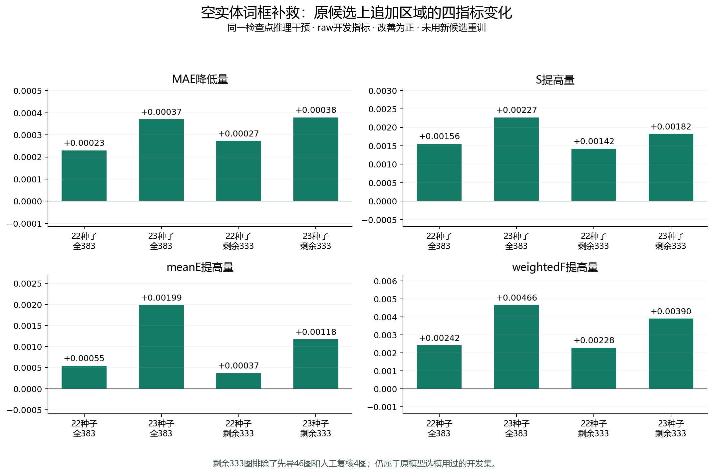

# 空实体词框补救：完整开发集与两个既有检查点结果

“空词”指大模型已提出实体（object）或部件（part）描述，但原分割器没有返回合法掩码。本轮只给这些词补一个可见范围定位框，再用SAM3生成掩码；旧候选原样保留，环境/动作/未知类词不补救。定位框的人工认可已记录，当前结果检验补救区域对COD是否有用。

下表使用同一候选直连结构、两个训练种子的原已选权重，比较“原候选”与“原候选＋补救区域”。没有新增一种RGB模型，也没有更换网络或分别为四指标挑权重。

**本轮是既有80轮直连权重的推理干预，没有使用新候选重新训练。** 完整383图属于开发集，原模型曾用它选模；剩余333图仅对本轮候选规则的先导探索未使用，仍不是官方测试集。

## 生成、原候选保留与复现

V1的定位和分割已全部完成，汇总时因本项目遗留的46张数量断言失败；V2只修正该汇总检查并复用所有生成记录。旧FAILED状态、日志和冻结源码保留，修复没有新增Qwen/SAM调用，也没有修改词、框或掩码。

首版seed22复核因依赖加载优先级错误，没有使用原冻结NumPy/Pillow，严格cached重放被拦截。恢复冻结依赖优先级后重新逐图验收，旧失败和实际加载路径/版本记录均保留；没有放宽相等标准。

- 383图中163图、215词补出245个掩码；原候选像素、角色、分数及原区域对几何均通过不变性检查。
- 原空实体/部件词217个，有效框215、拒答0、失败2。
- 2个失败词均返回了两个框，与预登记的单框接口契约不符；两次回复都保留，没有按GT挑一个框或合并坐标。对应图像与原空词仍保留，因此不能把这两项简单称为“模型完全无法定位”。
- 本轮新增Qwen调用186次；复用先导46图的33个框和补救掩码，不重复生成46图。先导原先使用33次Qwen调用，应另计。
- 净逐词定位278.9秒，净SAM/复制/包装112.9秒，均不含各阶段模型加载；不是端到端总耗时。

- seed20261023第31轮：cached与baseline逐图精确复现；220张无新增候选图逐项完全相等。MAE改善117图、退化46图；四项同时改善92图、同时退化27图。
- seed20261022第61轮：cached与baseline逐图精确复现；220张无新增候选图逐项完全相等。MAE改善112图、退化51图；四项同时改善88图、同时退化27图。

## raw：同检查点四指标

|种子/轮次|开发范围|候选输入|MAE↓|S↑|meanE↑|weightedF↑|
|---|---|---|---:|---:|---:|---:|
|20261023/31|完整383图|原候选|0.027578|0.859372|0.918118|0.770164|
|20261023/31|完整383图|原候选＋空词框补救|0.027207|0.861640|0.920106|0.774822|
|20261023/31|剩余333图确认|原候选|0.025027|0.883829|0.940203|0.811209|
|20261023/31|剩余333图确认|原候选＋空词框补救|0.024648|0.885650|0.941379|0.815109|
|20261023/31|先导46图|原候选|0.044615|0.704622|0.776388|0.505939|
|20261023/31|先导46图|原候选＋空词框补救|0.044338|0.709916|0.783202|0.514859|
|20261023/31|人工复核4图|原候选|0.044024|0.602933|0.709424|0.391701|
|20261023/31|人工复核4图|原候选＋空词框补救|0.043237|0.607666|0.723505|0.410474|
|20261022/61|完整383图|原候选|0.026824|0.860170|0.923619|0.776774|
|20261022/61|完整383图|原候选＋空词框补救|0.026594|0.861727|0.924164|0.779192|
|20261022/61|剩余333图确认|原候选|0.024429|0.882493|0.941715|0.815530|
|20261022/61|剩余333图确认|原候选＋空词框补救|0.024157|0.883914|0.942086|0.817805|
|20261022/61|先导46图|原候选|0.043546|0.713022|0.806548|0.518628|
|20261022/61|先导46图|原候选＋空词框补救|0.043648|0.715373|0.808164|0.521827|
|20261022/61|人工复核4图|原候选|0.033920|0.694026|0.763405|0.519057|
|20261022/61|人工复核4图|原候选＋空词框补救|0.033404|0.697718|0.766125|0.524348|

## png_standard：同检查点四指标

|种子/轮次|开发范围|候选输入|MAE↓|S↑|meanE↑|weightedF↑|
|---|---|---|---:|---:|---:|---:|
|20261023/31|完整383图|原候选|0.027557|0.860374|0.919731|0.770395|
|20261023/31|完整383图|原候选＋空词框补救|0.027185|0.862643|0.921697|0.775050|
|20261023/31|剩余333图确认|原候选|0.025005|0.884983|0.941717|0.811421|
|20261023/31|剩余333图确认|原候选＋空词框补救|0.024626|0.886804|0.942898|0.815321|
|20261023/31|先导46图|原候选|0.044596|0.704619|0.778720|0.506315|
|20261023/31|先导46图|原候选＋空词框补救|0.044317|0.709912|0.785311|0.515210|
|20261023/31|人工复核4图|原候选|0.044011|0.602846|0.711029|0.391831|
|20261023/31|人工复核4图|原候选＋空词框补救|0.043225|0.607577|0.725118|0.410606|
|20261022/61|完整383图|原候选|0.026813|0.860493|0.924873|0.776902|
|20261022/61|完整383图|原候选＋空词框补救|0.026583|0.862049|0.925425|0.779318|
|20261022/61|剩余333图确认|原候选|0.024418|0.882861|0.942934|0.815640|
|20261022/61|剩余333图确认|原候选＋空词框补救|0.024145|0.884282|0.943305|0.817914|
|20261022/61|先导46图|原候选|0.043534|0.713046|0.808040|0.518885|
|20261022/61|先导46图|原候选＋空词框补救|0.043638|0.715391|0.809710|0.522081|
|20261022/61|人工复核4图|原候选|0.033911|0.693992|0.764905|0.519166|
|20261022/61|人工复核4图|原候选＋空词框补救|0.033395|0.697689|0.767644|0.524461|

## 分数据来源核对（raw）

|种子|来源|候选输入|MAE↓|S↑|meanE↑|weightedF↑|
|---|---|---|---:|---:|---:|---:|
|20261023|CAMO|baseline|0.033865|0.873251|0.916190|0.807419|
|20261023|CAMO|treatment|0.033441|0.874963|0.918703|0.811104|
|20261023|COD10K-CAM|baseline|0.025475|0.854730|0.918763|0.757702|
|20261023|COD10K-CAM|treatment|0.025122|0.857184|0.920575|0.762686|
|20261022|CAMO|baseline|0.030153|0.890967|0.938735|0.841303|
|20261022|CAMO|treatment|0.029800|0.892012|0.939976|0.842424|
|20261022|COD10K-CAM|baseline|0.025711|0.849869|0.918563|0.755189|
|20261022|COD10K-CAM|treatment|0.025522|0.851596|0.918875|0.758041|

## 配对MAE变化的不确定性

变化定义为补救−原候选，负值为改善。按图像配对重抽样10000次，固定随机种子20261113；这是开发数据的描述性区间，不是独立测试上的显著性结论。

- seed20261023 完整383图：平均ΔMAE=-0.0003708，95%分位区间[-0.0005724, -0.0001680]。
- seed20261023 剩余333图确认：平均ΔMAE=-0.0003788，95%分位区间[-0.0006095, -0.0001543]。
- seed20261022 完整383图：平均ΔMAE=-0.0002301，95%分位区间[-0.0004758, +0.0000200]。
- seed20261022 剩余333图确认：平均ΔMAE=-0.0002726，95%分位区间[-0.0005582, +0.0000018]。

## 候选几何（GT仅用于生成后诊断）

|范围|候选输入|最佳单候选IoU|并集召回|并集精度|背景覆盖|
|---|---|---:|---:|---:|---:|
|完整383图|baseline|0.523347|0.603335|0.285801|0.413386|
|完整383图|treatment|0.691136|0.792928|0.338250|0.453708|
|剩余333图确认|baseline|0.541738|0.615231|0.293555|0.425386|
|剩余333图确认|treatment|0.718582|0.807276|0.348277|0.457060|
|先导46图|baseline|0.404248|0.524839|0.230953|0.327069|
|先导46图|treatment|0.507611|0.706261|0.270961|0.432207|
|人工复核4图|baseline|0.361877|0.515680|0.271068|0.407010|
|人工复核4图|treatment|0.516796|0.595044|0.277351|0.421892|

候选并集含环境辅助区域，不能视为最终COD前景。最佳IoU是事后oracle指标，不参与词、框、掩码选择。

追加区域的新信息量也作了事后核对：245个新增掩码中，27个与原某掩码IoU≥0.95，像素完全相同0个；138张补出了原候选并集之外的GT可见像素，另25张虽有新增掩码但没有新增GT覆盖。该分析没有删除重复或背景候选，也不把重复区域简单当作无用；本轮不能把全部COD变化归因于补出新目标像素。

## 计算开销

状态DONE；GPU实测名称：NVIDIA GeForce RTX 4090。FP32、352×352、batch=1；4轮交替、每块20次预热＋40次CUDA计时。参数新增0。

|原候选数量层|原→新区域数|原候选前向ms|补救前向ms|相对变化|
|---|---:|---:|---:|---:|
|five_plus|7→8|33.707|33.783|+0.23%|
|two_to_four|2→3|33.704|33.767|+0.19%|
|empty|0→1|33.414|33.368|-0.14%|
|one|1→3|33.387|33.739|+1.05%|

每层仅固定一张发生补救的图，按原验证顺序选取，不据GT/指标挑选；数值是4个块中位数的中位数，原始块及P90保留。只测CUDA前向，不含磁盘、离线Qwen/SAM，不能当端到端FPS。并发进程只在块边界核验，隔离性限制如实保留。

## 结论与下一步

空实体词框补救值得进入等预算训练验证：完整383图上，两个既有检查点的raw/PNG四指标均改善，MAE相对下降0.86%（seed22）与1.34%（seed23）。排除先导46和人工复核4图后，剩余333图四项方向仍一致，MAE相对下降1.12%与1.51%。CAMO与COD10K-CAM两个来源分组的均值也均改善。

这仍是小幅的开发集收益，不写成已经获得稳定的新训练方法。seed22的配对MAE重抽样区间包含0；其先导46图MAE也略有退化。两个种子分别仍有51/46图MAE退化，各有27图四项同时退化。固定六例中BatFish-7补出了错误目标/环境候选，最终预测将右下圆形贝壳区域误分为前景，保留该负例。

COD网络参数没有增加；在4张固定分层输入上，前向中位计时相对变化约−0.14%至+1.05%，属于小幅变化，不能解读为普遍加速。新增成本主要在离线定位与分割；当前只测了开发图，不据此承诺整个系统的FPS或全部训练数据吞吐。

下一步已只读清点训练缓存：3652图中1734图涉及2354个空实体/部件词。先完整生成这部分稀疏补救缓存，保留原9147掩码和323张原零候选图；再比较同一普通直连结构在原/新候选上的两个种子等预算10轮，确认训练收益后才扩80轮。候选改善与融合结构增量分开验证。

## 未完成与边界

本轮没有生成3652张训练图的新补救先验、没有用新先验重新训练、没有在官方测试集评价；尚不能声称训练收益或论文性能排名。已有80轮训练和冻结选择规则不变。
