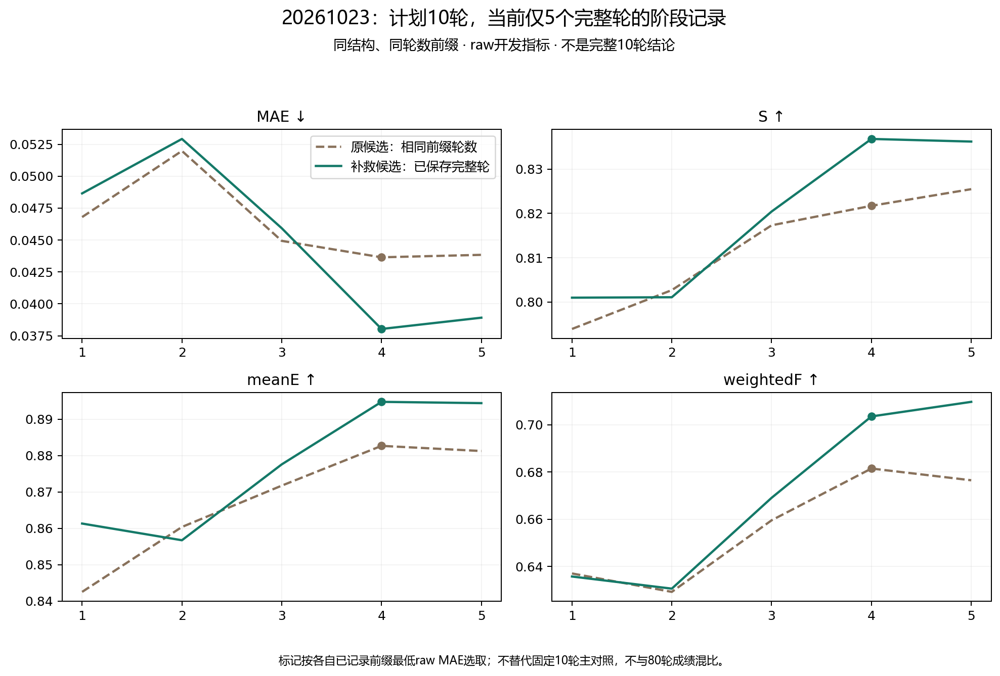

# 空实体词补救：缓存验收与训练阶段记录

这是原/新候选的同结构训练对照；与此前既有80轮权重的推理补救试验分开。固定3652训练/383开发，不使用官方测试集。每组原raw开发MAE选一个检查点，四指标同检查点，不能与80轮最好成绩混比。

当前验收状态：PARTIAL。未完成条件不填入完整10轮主表。

本次按用户两小时授权于UTC10:39:51（北京时间18:39:51）停止。训练缓存已完成；seed20261023保留5/10轮完整检查点，seed20261024尚未启动。队列原控制文件记录TimeoutExpired/FAILED，对应外部授权时限触发，不是非有限损失或数据错误；原控制文件保留，不改写成成功。

## 缓存与配对验收

训练2354个空词，定位有效框2293、拒答2、错误59；调用2430次。
训练1691图、2278词增加2650个掩码；原9147个掩码保留，20张补救后仍无候选的训练图保留。全部4035包验收通过，GT与划分不变。
历史两种子控制的模型/训练源码、初始化、全部10轮顺序与学习率已核对完全兼容，复用其记录；没有重复训练RGB。新训练使用未修改的原训练器，计划每种子10轮、4570更新；实际完整轮次另列。原323张零候选训练图全部在清单中。
训练SAM数值运行时对开发215个有效框词的全部掩码与分数重放精确一致；已有开发383份补救缓存直接复用。

尚无完成10轮且通过独立验收的新条件；当前不能判断训练收益。

## 训练×推理候选四格诊断（raw）

各训练条件保留原已选检查点，不按交叉结果重新选模。

完整四格诊断未完成；不据不完整交叉表作机制结论。

## 未完成条件（不混入10轮公平对照）

- 20261023：5/10完整轮，检查点包含2285更新，最后摘要文件状态RUNNING；任务已按授权截止退出，尚未完成10轮独立验收。以截止后完整检查点回读收据核对可续跑轮次。
  前缀最低raw-MAE轮次4，raw MAE/S/meanE/weightedF=0.038033/0.836805/0.894783/0.703587；仅作部分进度，不与完成10轮控制宣称公平收益。
  前缀最低raw-MAE轮次4，png_standard MAE/S/meanE/weightedF=0.037887/0.836867/0.896765/0.705256；仅作部分进度，不与完成10轮控制宣称公平收益。

  对齐当前5个完整轮的中途观察（计划仍为10轮，不能替代主对照）：

|同轮数前缀输入|前缀选中轮|MAE↓|S↑|meanE↑|weightedF↑|
|---|---:|---:|---:|---:|---:|
|原候选前缀|4|0.043648|0.821711|0.882684|0.681522|
|补救候选前缀|4|0.038033|0.836805|0.894783|0.703587|

- 20261024：尚未启动。

## 结论、问题与后续

当前同种子、同5轮前缀的中途观察四指标均改善，MAE相对降低约12.9%；两组前缀均按raw MAE选中第4轮。这是继续完成固定10轮试验的依据，不能把单种子5轮前缀替代两种子10轮结论，也不能和80轮性能混为一表。

下一步从seed23第5完整轮检查点恢复第6轮，补完10轮及其关闭先验干预/独立验收，再训练seed24完整10轮，最后完成训练×推理四格诊断。训练候选无需重生成，既有原控制无需重训；训练预算和学习率配方保持不变，不自动启动80轮。

新训练的完整10轮收益、逐图损益、第二种子复现与四格机制诊断均未完成，负结果和未完成项继续保留。

空候选批次没有新增跳过规则，完整预算应为4570更新，未满预算条件按检查点实际保留轮数另列；原训练器未逐批记录全空计数，该数量未测，不以缓存零候选图数替代。

本轮未在官方测试集验证，尚不能作为论文排名或泛化结论。环境候选和局部部件继续保留，不因前景纯度低而事后删除。

截止中断的未完整epoch可能已经执行部分优化步骤，但这些未提交的步骤不计入可续跑检查点。原训练器没有逐步持久化总计数，不能把检查点更新数当作含废弃部分的全部计算消耗；下一次从完整epoch恢复会以相同种子/顺序重放该轮。
