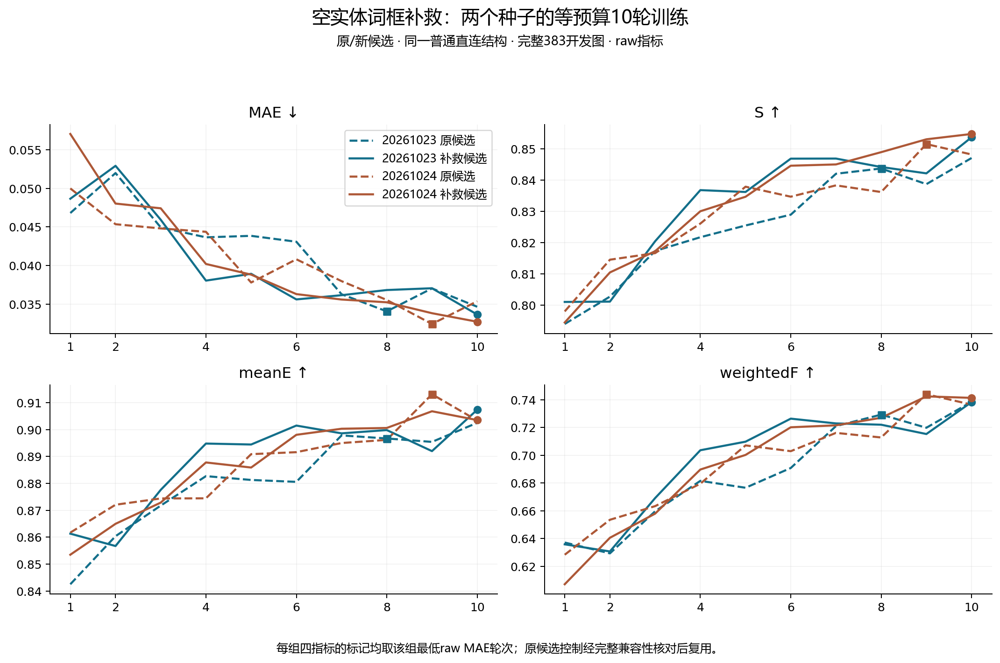

# 空实体词补救：两个种子10轮训练结果

这是原/新候选的同结构训练对照；与此前既有80轮权重的推理补救试验分开。固定3652训练/383开发，不使用官方测试集。每组原raw开发MAE选一个检查点，四指标同检查点，不能与80轮最好成绩混比。

当前验收状态：PASS。未完成条件不填入完整10轮主表。

两个新条件已于2026-11-13北京时间21:39完成：各10轮、4570次已提交优化器更新，独立验收和完整四格评价PASS；本地逐图复算也通过。PASS表示流程和数值验收通过，不表示性能全面改善。本次队列已结束，没有启动80轮。

[交叉评价、关闭先验、逐图退化与配对区间](空实体词补救训练交叉评价_20261113.md) · [此前五轮阶段记录](空实体词补救训练五轮阶段记录_20261113.md)。

## 缓存与配对验收

训练2354个空词，定位有效框2293、拒答2、错误59；调用2430次。
训练1691图、2278词增加2650个掩码；原9147个掩码保留，20张补救后仍无候选的训练图保留。全部4035包验收通过，GT与划分不变。
历史两种子控制的模型/训练源码、初始化、全部10轮顺序与学习率已核对完全兼容，复用其记录；没有重复训练RGB。新训练使用未修改的原训练器，计划每种子10轮、4570更新；实际完整轮次另列。原323张零候选训练图全部在清单中。
训练SAM数值运行时对开发215个有效框词的全部掩码与分数重放精确一致；已有开发383份补救缓存直接复用。

## raw

|种子|训练候选|选中轮次|MAE↓|S↑|meanE↑|weightedF↑|
|---|---|---:|---:|---:|---:|---:|
|20261023|原候选|8|0.034046|0.843740|0.896671|0.729257|
|20261023|原候选＋空词补救|10|0.033635|0.853749|0.907329|0.738284|
|20261024|原候选|9|0.032410|0.851561|0.913095|0.743935|
|20261024|原候选＋空词补救|10|0.032700|0.854805|0.903504|0.741324|

## png_standard

|种子|训练候选|选中轮次|MAE↓|S↑|meanE↑|weightedF↑|
|---|---|---:|---:|---:|---:|---:|
|20261023|原候选|8|0.033954|0.844091|0.898459|0.730293|
|20261023|原候选＋空词补救|10|0.033547|0.854132|0.909089|0.739180|
|20261024|原候选|9|0.032323|0.851901|0.914933|0.744842|
|20261024|原候选＋空词补救|10|0.032603|0.855208|0.905338|0.742590|

## 逐图损益（raw）

- 20261023：MAE改善228图、退化155图；四项同改善172图、四项同退化103图。
- 20261024：MAE改善224图、退化159图；四项同改善168图、四项同退化104图。

## 训练×推理候选四格诊断（raw）

各训练条件保留原已选检查点，不按交叉结果重新选模。

|种子|训练候选|推理候选|MAE↓|S↑|meanE↑|weightedF↑|
|---|---|---|---:|---:|---:|---:|
|20261023|original|original|0.034046|0.843740|0.896671|0.729257|
|20261023|original|rescue|0.033328|0.846752|0.901674|0.736318|
|20261023|rescue|rescue|0.033635|0.853749|0.907329|0.738284|
|20261023|rescue|original|0.034210|0.851572|0.902596|0.731947|
|20261024|original|original|0.032410|0.851561|0.913095|0.743935|
|20261024|original|rescue|0.031866|0.852964|0.915278|0.748706|
|20261024|rescue|rescue|0.032700|0.854805|0.903504|0.741324|
|20261024|rescue|original|0.033067|0.851304|0.896029|0.732417|

## 结论、问题与后续

完整10轮结果没有复现两个种子四指标稳定改善：seed20261023四项改善，raw MAE相对下降1.21%；seed20261024仅S改善，MAE相对升高0.90%，meanE和weightedF均下降。PNG标准口径方向一致。前5轮12.9%的观察不能替代最终固定预算结果。

四格显示：保留原训练权重、仅在推理时补救候选，两个种子四指标均改善，raw MAE分别下降约2.11%/1.68%。而在同一补救推理输入下，补救候选重训模型的MAE均高于原候选训练模型；训练适应没有带来稳定额外收益，但包含各自预定检查点选择的影响，不能据此证明充分训练必然无效。

当前保留候选补救作为推理增强证据，暂缓直接扩大补救候选重训到80轮。下一步优先复核训练曲线和固定退化图中的新增背景/重复区域，区分候选输入收益与训练扰动；不根据开发GT事后筛候选，不修改当前结果。两个新条件的最佳轮均为第10轮，尚不足判断充分训练效果。需要新的预登记对照再决定长训投入。

空候选批次没有新增跳过规则，实际更新4570已核对；原训练器未逐批记录全空计数，该数量未测，不以缓存零候选图数替代。

本轮未在官方测试集验证，尚不能作为论文排名或泛化结论。环境候选和局部部件继续保留，不因前景纯度低而事后删除。
