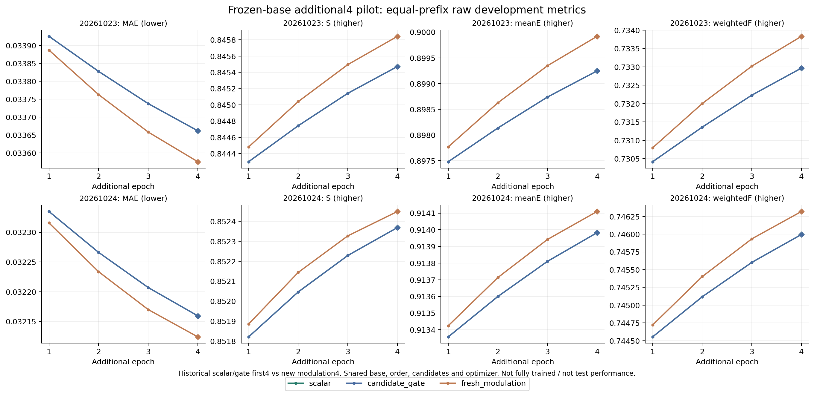
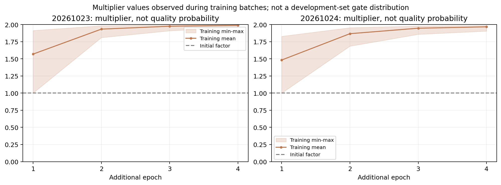

# 新调制器有限四轮试验

新头固定原门控、使用起始因子为1的独立乘性调制。与历史scalar/candidate_gate各自相同完成轮数的前缀按raw MAE选检查点；全部四项来自该同一检查点。不是额外十轮完整性能结果，不能与80轮主表混比。

文件名中的“非饱和”指新头初始化时的梯度路径；训练后是否再次饱和由实测统计判断，不预设结论。新因子范围0–2，也扩大了支持系数的可行范围，且权重同时进入新增分支的分子/分母；不能把增益纯归于梯度恢复。历史前四轮只复用当时已验收epoch JSON，历史前四轮选中权重不再单独保留，不虚构该行的新图像或开关重放。运行采用自己的分配器显存上限25%，不修改其他进程，共卡耗时不是隔离速度比较。

队列状态：DONE；预定每种子4轮，原截止不延长。

## 20261023，相同4轮前缀：raw

|条件|选中轮|MAE↓|S↑|meanE↑|weightedF↑|
|---|---:|---:|---:|---:|---:|
|scalar|4|0.03366199|0.84547178|0.89924616|0.73296703|
|candidate_gate|4|0.03366197|0.84547186|0.89924632|0.73296722|
|fresh_modulation|4|0.03357567|0.84584301|0.89991816|0.73383145|

## 20261023，相同4轮前缀：png_standard

|条件|选中轮|MAE↓|S↑|meanE↑|weightedF↑|
|---|---:|---:|---:|---:|---:|
|scalar|4|0.03356916|0.84582386|0.90101374|0.73400027|
|candidate_gate|4|0.03356915|0.84582394|0.90101388|0.73400043|
|fresh_modulation|4|0.03348259|0.84619712|0.90168751|0.73486400|

### 相对同预算标量分支的逐图变化

下表为新调制器减scalar。图像配对自助区间只描述当前开发图和已选检查点，不包含选模不确定性、跨种子方差或潜在近重复依赖，不是独立测试显著性结论。固定5000次重采样，不据区间改选轮次。

|指标|均值变化|配对图像95%区间|
|---|---:|---|
|mae|-0.00008632|[-0.00012632, -0.00004760]|
|sm|+0.00037122|[+0.00018429, +0.00058460]|
|mean_e|+0.00067200|[+0.00041485, +0.00095237]|
|wfm|+0.00086442|[+0.00059013, +0.00115787]|

|误差统计|scalar|fresh_modulation|
|---|---:|---:|
|false_positive_rate均值|0.01370372|0.01380038|
|false_negative_rate均值|0.20078547|0.19861357|
|largest_false_positive_component_image_fraction均值|0.00631020|0.00633804|
|最大误分块占图比例P95|0.02303128|0.02303230|

|完整轮|beta|真实更新/访问|全空跳过|因子最小/均值/最大|临近边界比例|新头梯度绝对和|
|---|---:|---|---:|---|---:|---:|
|1|0.031413|455/457|2|1.00000/1.56830/1.91241|0.00000|5.372869|
|2|0.057918|910/914|4|1.80936/1.93263/1.98156|0.00000|2.850595|
|3|0.082724|1364/1371|7|1.90865/1.97475/1.99429|0.00757|1.417777|
|4|0.104305|1819/1828|9|1.95902/1.98758/1.99615|0.41121|0.843274|

因子统计覆盖本轮训练过程中输入有效的新增候选，阈值为小于0.01或大于1.99；它不是质量概率，也不是完整开发集的门控分布。

本条件记录耗时3400.6秒，含训练、逐轮评价及已执行的末尾重放，未含离线生成；共卡运行，不与历史条件直接比较硬件效率。

## 20261024，相同4轮前缀：raw

|条件|选中轮|MAE↓|S↑|meanE↑|weightedF↑|
|---|---:|---:|---:|---:|---:|
|scalar|4|0.03215939|0.85236882|0.91398266|0.74599572|
|candidate_gate|4|0.03215938|0.85236883|0.91398268|0.74599575|
|fresh_modulation|4|0.03212405|0.85244935|0.91410977|0.74631946|

## 20261024，相同4轮前缀：png_standard

|条件|选中轮|MAE↓|S↑|meanE↑|weightedF↑|
|---|---:|---:|---:|---:|---:|
|scalar|4|0.03207212|0.85270985|0.91583551|0.74690011|
|candidate_gate|4|0.03207211|0.85270985|0.91583553|0.74690014|
|fresh_modulation|4|0.03203684|0.85279058|0.91596593|0.74722154|

### 相对同预算标量分支的逐图变化

下表为新调制器减scalar。图像配对自助区间只描述当前开发图和已选检查点，不包含选模不确定性、跨种子方差或潜在近重复依赖，不是独立测试显著性结论。固定5000次重采样，不据区间改选轮次。

|指标|均值变化|配对图像95%区间|
|---|---:|---|
|mae|-0.00003534|[-0.00005483, -0.00001471]|
|sm|+0.00008053|[-0.00000111, +0.00016211]|
|mean_e|+0.00012711|[+0.00000721, +0.00024994]|
|wfm|+0.00032375|[+0.00019285, +0.00045354]|

|误差统计|scalar|fresh_modulation|
|---|---:|---:|
|false_positive_rate均值|0.01878452|0.01885391|
|false_negative_rate均值|0.16242759|0.16124512|
|largest_false_positive_component_image_fraction均值|0.00937861|0.00945939|
|最大误分块占图比例P95|0.03421504|0.03572969|

|完整轮|beta|真实更新/访问|全空跳过|因子最小/均值/最大|临近边界比例|新头梯度绝对和|
|---|---:|---|---:|---|---:|---:|
|1|0.024449|455/457|2|0.99926/1.48188/1.82786|0.00000|3.840629|
|2|0.046947|909/914|5|1.68463/1.86611/1.95332|0.00000|2.651278|
|3|0.066351|1364/1371|7|1.85697/1.94599/1.97770|0.00000|1.622653|
|4|0.081645|1818/1828|10|1.90419/1.96611/1.98563|0.00000|1.193996|

因子统计覆盖本轮训练过程中输入有效的新增候选，阈值为小于0.01或大于1.99；它不是质量概率，也不是完整开发集的门控分布。

本条件记录耗时3418.7秒，含训练、逐轮评价及已执行的末尾重放，未含离线生成；共卡运行，不与历史条件直接比较硬件效率。

## 固定选中权重的调制器干预

beta、其他参数及选中epoch固定。factor1恢复初始调制因子；uniform_effective_mean保持逐图有效门控均值并改为均匀分配，单新增候选图精确保留真实输出。不读GT决定权重、不重新选模；均值匹配不保证逐像素支持图或残差范数相同，也不能代替仅bias控制的独立重训。

### 20261023：raw

|干预|MAE↓|S↑|meanE↑|weightedF↑|
|---|---:|---:|---:|---:|
|real|0.03357567|0.84584301|0.89991816|0.73383145|
|factor1|0.03366197|0.84547186|0.89924630|0.73296722|
|uniform_effective_mean|0.03357566|0.84584295|0.89991796|0.73383129|

### 20261023：png_standard

|干预|MAE↓|S↑|meanE↑|weightedF↑|
|---|---:|---:|---:|---:|
|real|0.03348259|0.84619712|0.90168751|0.73486400|
|factor1|0.03356915|0.84582393|0.90101388|0.73400042|
|uniform_effective_mean|0.03348258|0.84619706|0.90168729|0.73486385|

有效单新增候选图109，多新增候选图54；以下raw差异为真实分配减均匀均值匹配：

|范围|ΔMAE|ΔS|ΔmeanE|ΔweightedF|
|---|---:|---:|---:|---:|
|all383|+1.38294107e-08|+5.53574616e-08|+2.00718906e-07|+1.63342394e-07|
|multi_added|+9.80863762e-08|+3.92627922e-07|+1.42361742e-06|+1.15852105e-06|

全部图中真实分配与均匀控制的单图MAE绝对差最大为3.65078449e-06。

### 20261024：raw

|干预|MAE↓|S↑|meanE↑|weightedF↑|
|---|---:|---:|---:|---:|
|real|0.03212405|0.85244935|0.91410977|0.74631946|
|factor1|0.03217052|0.85233673|0.91394212|0.74590374|
|uniform_effective_mean|0.03212404|0.85244939|0.91410931|0.74631913|

### 20261024：png_standard

|干预|MAE↓|S↑|meanE↑|weightedF↑|
|---|---:|---:|---:|---:|
|real|0.03203684|0.85279058|0.91596593|0.74722154|
|factor1|0.03208324|0.85267772|0.91579416|0.74680825|
|uniform_effective_mean|0.03203682|0.85279058|0.91596545|0.74722117|

有效单新增候选图109，多新增候选图54；以下raw差异为真实分配减均匀均值匹配：

|范围|ΔMAE|ΔS|ΔmeanE|ΔweightedF|
|---|---:|---:|---:|---:|
|all383|+1.50525315e-08|-3.85211190e-08|+4.52503455e-07|+3.31592405e-07|
|multi_added|+1.06761473e-07|-2.73214603e-07|+3.20942265e-06|+2.35184983e-06|

全部图中真实分配与均匀控制的单图MAE绝对差最大为6.29201531e-06。

## 本轮判断与下一步

新调制器确实恢复了可学习梯度，四轮平均四指标也有小幅改善；但在同一检查点将候选改为逐图等均值的均匀权重后，平均指标几乎不变。54张多新增候选图也单列复核，暂未看到有实际幅度的候选间分配收益。该诊断保留逐图均值，仍不能断言一项全局常量一定等价，必须补仅bias训练控制。

同时，两个种子的背景误分均值略升，seed24最大误分块P95上升；按用户优先避免明显背景误分的偏好，本轮不将新调制器列为默认改进，不直接扩大80轮。先做2参数仅bias控制，排除聚合尺度和训练轨迹的影响；随后再检验原候选集合覆盖与原融合贡献的条件信息。任务有用性监督留到这些信息确有帮助之后，另行登记，不悄悄改损失。

[起点、梯度及机制证据](可回退门控机制与任务有用性_20261114.md) · [登记与授权](三小时推进与后续路线_20261114.md)。

