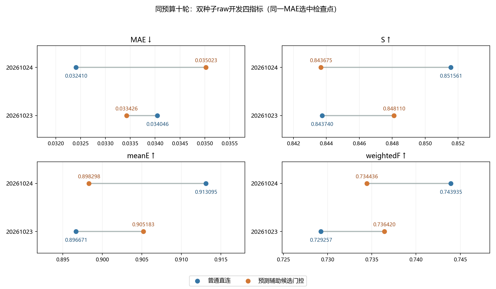

# 预测辅助候选门控双种子复验｜2026-11-13

种子20261023与20261024，CAM-only训练3652/开发383张。每个条件十个完整epoch、4570次优化器更新，四指标来自按最低raw开发MAE选中的同一检查点。未使用官方测试集调参或评价。

## raw

|种子|方案|选中轮次|MAE↓|S↑|meanE↑|weightedF↑|
|---|---|---:|---:|---:|---:|---:|
|20261023|普通直连|8|0.034046|0.843740|0.896671|0.729257|
|20261023|预测辅助候选门控|10|0.033426|0.848110|0.905183|0.736420|
|20261024|普通直连|9|0.032410|0.851561|0.913095|0.743935|
|20261024|预测辅助候选门控|10|0.035023|0.843675|0.898298|0.734436|

|种子|新门控减直连：MAE|S|meanE|weightedF|MAE相对降幅|
|---|---:|---:|---:|---:|---:|
|20261023|-0.000619|+0.004370|+0.008512|+0.007163|+1.82%|
|20261024|+0.002613|-0.007886|-0.014797|-0.009499|-8.06%|

## png_standard

|种子|方案|选中轮次|MAE↓|S↑|meanE↑|weightedF↑|
|---|---|---:|---:|---:|---:|---:|
|20261023|普通直连|8|0.033954|0.844091|0.898459|0.730293|
|20261023|预测辅助候选门控|10|0.033330|0.848461|0.906913|0.737478|
|20261024|普通直连|9|0.032323|0.851901|0.914933|0.744842|
|20261024|预测辅助候选门控|10|0.034945|0.843990|0.900559|0.735343|

|种子|新门控减直连：MAE|S|meanE|weightedF|MAE相对降幅|
|---|---:|---:|---:|---:|---:|
|20261023|-0.000624|+0.004370|+0.008453|+0.007185|+1.84%|
|20261024|+0.002622|-0.007911|-0.014374|-0.009499|-8.11%|

## 方向与限制

20261023改善指标：mae、sm、mean_e、wfm；未改善指标：无。
20261024改善指标：无；未改善指标：mae、sm、mean_e、wfm。

这里只描述两个选中开发验证权重的变化，不能据此证明统计显著性、充分训练收益或测试泛化。负指标及退化子集均保留。

## raw开发子集差值（新门控减普通直连）

|种子|开发子集|MAE|S|meanE|weightedF|
|---|---|---:|---:|---:|---:|
|20261023|CAMO|-0.001633|+0.008883|+0.013823|+0.010104|
|20261023|COD10K-CAM|-0.000281|+0.002861|+0.006735|+0.006179|
|20261024|CAMO|+0.001815|-0.010615|-0.012006|-0.009741|
|20261024|COD10K-CAM|+0.002880|-0.006973|-0.015731|-0.009418|

## 逐图与候选分层诊断

两种子同时改善106张、同时退化83张、方向混合194张。第二个种子虽然206张的MAE改善、177张退化，整体均值仍更差，说明不能只看改善图数。
沿用先前描述阈值：最佳候选IoU≥0.5的222张在两种子上四项均较直连弱；最佳IoU介于0.1与0.5的31张在两个种子中方向相反。完整raw/PNG分层差值见STRATA.json/CSV。
分层使用开发GT，只作事后诊断，不能作为模型输入、筛选候选或因果解释。空候选层跨模型的变化可能来自不同的已训练RGB参数。

两个新门控运行的模型及构建源码SHA完全一致。各自与历史同种子直连的初始化、数据签名、样本顺序、优化器和学习率一致，选中权重逐图重推与32空候选回退均通过。

种子20261023的空间叠加版本退化，作为负结果保留。同模块纯RGB控制也弱于候选门控。空间版本另有额外可训练参数，扩大预算前需补其对应的RGB空间控制。

种子20261023的隔离GPU测量中，四种固定候选数量输入的预测门控前向中位耗时比普通直连增加约12%–14%（RTX4090、FP32、352×352、batch1）。计时不含离线先验生成及磁盘读取，不能等同端到端吞吐。

[Seed23 complete ablations and cost](RGB预测辅助门控执行结果_20261112.md)

## 同权重关闭新增预测反馈

两种子各自先精确复现选中权重的383张逐图结果，再临时将prediction_gate输出置零。所有候选、共享粗预测计算和权重保持原样，状态摘要未改变。
下表为“开启减关闭”的四指标差，来自同一检查点；MAE负数表示开启略好，其余三项正数表示开启略好。

|种子|协议|ΔMAE|ΔS|ΔmeanE|ΔweightedF|
|---|---|---:|---:|---:|---:|
|20261023|raw|-9.417e-08|+2.339e-07|+2.442e-07|+7.322e-07|
|20261023|png_standard|-8.939e-08|+2.148e-07|+2.517e-07|+6.721e-07|
|20261024|raw|-6.782e-08|+1.863e-07|+2.792e-07|+6.078e-07|
|20261024|png_standard|-6.530e-08|+1.968e-07|+2.999e-07|+5.845e-07|

关闭后的MAE变化仅约10⁻⁷，远小于新模型与普通直连之间约10⁻³的差异。在这两个选中权重上，新增反馈的直接作用几乎为零，不能将第一种子的改善直接归因于这条信号。
同权重开关不等于重新训练对照。若继续研究该机制，应先补同一路径、固定零或常量反馈的训练对照，区分信号利用与训练轨迹变化；当前不扩大80轮预算。

